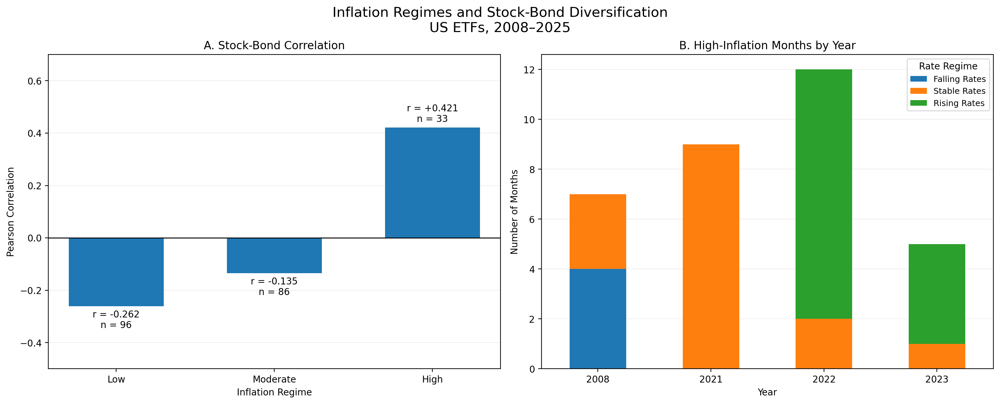
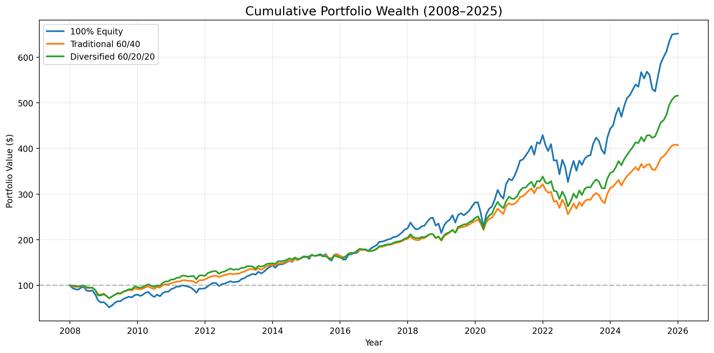
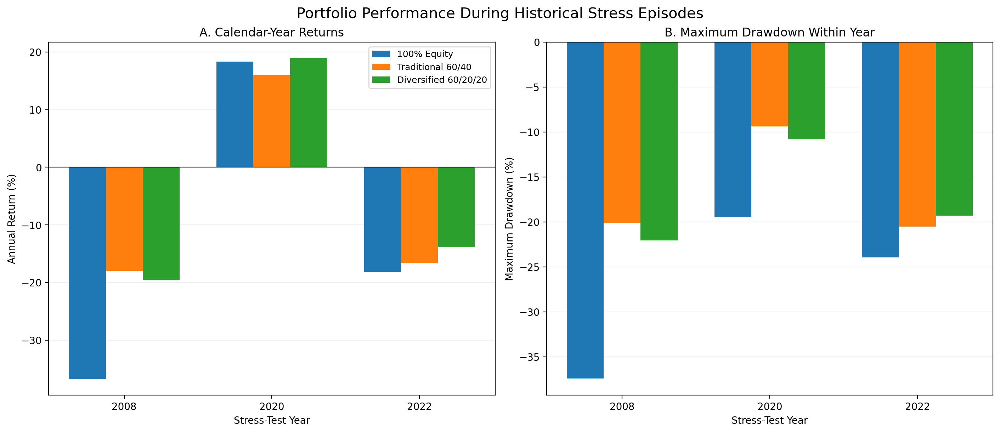
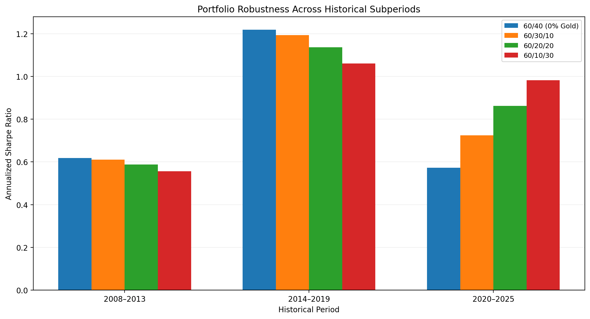

# Macroeconomic Regimes & Portfolio Performance

**An empirical analysis of inflation, monetary policy, and investment risk in the United States (2008–2025).**

This research project investigates how relationships among equities, intermediate-term US Treasury bonds, and gold differ across macroeconomic environments—and what those differences imply for portfolio diversification. It combines macroeconomic data, ETF return analysis, correlation and econometric testing, portfolio backtests, and sensitivity checks.

**Research question:** *Does high inflation coincide with weaker stock–bond diversification, and how did adding gold change historical portfolio outcomes?*

> **Interpretation:** The results are historical, descriptive, and in-sample. They do not establish causality, constitute a real-time inflation-timing strategy, or guarantee future investment performance.

## Executive summary

- **Stock–bond relationships changed across inflation regimes.** Monthly SPY–IEF Pearson correlation was **−0.262** in low-inflation months (96 observations) and **+0.421** in high-inflation months (33 observations).
- **Statistical evidence was sensitive to 2022.** A full-sample interaction regression estimated the high-inflation slope difference at **+0.297** (HAC(12) *p* = **0.0044**), but the estimate became **+0.168** (*p* = **0.1133**) when 2022 was excluded.
- **Gold improved historical portfolio performance, but statistical superiority was not established.** The monthly-rebalanced 60% SPY / 20% IEF / 20% GLD portfolio achieved a Sharpe ratio of **0.803**, compared with **0.720** for the traditional 60/40 portfolio. However, paired circular moving-block bootstrap confidence intervals for the Sharpe difference of +0.0828 included zero (six-month blocks: **[-0.0660, 0.2221]**; 12-month blocks: **[-0.0782, 0.2301]**). Excluding 2025 reduced the Sharpe advantage from +0.083 to +0.041, while the 2008–2019 comparison favored the traditional 60/40 portfolio.
- **The benefit was not stable across time.** The traditional 60/40 allocation had a higher Sharpe ratio in **2008–2013** and **2014–2019**; gold-inclusive portfolios performed better in **2020–2025**.

## Data and definitions

| Component | Source or instrument | Frequency / convention |
|---|---|---|
| CPI | FRED [`CPIAUCSL`](https://fred.stlouisfed.org/series/CPIAUCSL) | Monthly, year-over-year percentage change |
| Effective federal funds rate | FRED [`FEDFUNDS`](https://fred.stlouisfed.org/series/FEDFUNDS) | Monthly average; month-to-month percentage-point change |
| Unemployment | FRED [`UNRATE`](https://fred.stlouisfed.org/series/UNRATE) | Monthly percentage rate |
| Risk-free proxy | FRED [`GS3M`](https://fred.stlouisfed.org/series/GS3M) | Prior-month annualized yield, approximated as monthly yield / 12 |
| Equities | `SPY` | Adjusted price-based ETF returns |
| Treasuries | `IEF` | Adjusted price-based ETF returns |
| Gold | `GLD` | Adjusted price-based ETF returns |

ETF price history was collected with [`yfinance`](https://pypi.org/project/yfinance/). The financial sample includes **216 monthly returns** (January 2008–December 2025). **215** observations have a usable CPI inflation classification; one observation is missing.

**Inflation regimes:** low = below 2%, moderate = 2% to below 4%, high = 4% or above (CPI YoY). These are research-defined thresholds and are **not** a direct implementation of the Federal Reserve's PCE inflation target.

**Monetary policy classifications:** rising rate when the monthly change in `FEDFUNDS` exceeds +0.10 percentage points, falling when below −0.10, stable otherwise. Monthly changes in the effective rate are not identical to dated FOMC decisions.

**Date alignment:** Financial returns use month-end price observations, though the monthly rows are labeled by the first day of the corresponding month. Inflation classification uses realized **same-month** CPI, which is published after the month ends. Consequently, regime-conditioned performance is an **ex-post** description and is not an investable contemporaneous strategy.

## Results

### 1. Stock–bond correlations by inflation regime

| CPI inflation regime | Observations | SPY–IEF monthly correlation |
|---|---:|---:|
| Low (<2%) | 96 | −0.262 |
| Moderate (2%–<4%) | 86 | −0.135 |
| High (≥4%) | 33 | +0.421 |



The positive correlation in high-inflation months also appeared when the high-inflation threshold was varied from **3% to 6%** (observed Pearson correlations +0.279 to +0.617). These subsets overlap, and high-inflation months are concentrated in few historical episodes.

### 2. Statistical validation

- Classical two-sided Fisher Z-test of the low–high correlation difference: **Z = 3.4147**, **p = 0.000639**. Classical inference relies on independence-related assumptions that are questionable for consecutive monthly observations.
- Moving block bootstrap, 95% percentile intervals for the correlation difference: **[0.102, 1.030]** using six-month blocks and **[0.004, 1.054]** using 12-month blocks. Results depend on block construction and the limited number of episodes.
- OLS interaction model, IEF monthly return as outcome, SPY return and regime interactions as predictors: **SPY × High Inflation = +0.2968**; **HAC(12) p = 0.0044**; 95% CI **[0.0923, 0.5013]**; model **R² = 0.081**.
- Excluding **2022**: coefficient **+0.1677**, **HAC(12) p = 0.1133**, 95% CI **[−0.0399, 0.3752]**. This is an important limitation of the full-sample result.

The regression concerns a **difference in conditional return slopes**, which is related to but not identical to a difference in Pearson correlations. Neither test identifies a causal effect of inflation.

### 3. Full-sample portfolio performance

All three portfolios below use **monthly rebalancing**, no leverage, and no transaction cost or tax deductions.

| Portfolio | CAGR | Ann. volatility | Sharpe | Max drawdown | Final value of $100 |
|---|---:|---:|---:|---:|---:|
| 100% SPY | 10.972% | 15.674% | 0.659 | −48.219% | $651.34 |
| 60% SPY / 40% IEF | 8.114% | 9.626% | 0.720 | −28.490% | $407.25 |
| 60% SPY / 20% IEF / 20% GLD | 9.541% | 10.397% | 0.803 | −28.116% | $515.68 |



Replacing half the bond sleeve with gold increased the observed **CAGR and Sharpe ratio** but also **increased full-sample volatility** relative to 60/40.

### 4. Stress episodes

| Calendar year | 100% SPY | 60/40 | 60/20/20 | 60/20/20 minus 60/40 |
|---|---:|---:|---:|---:|
| 2008 | −36.795% | −18.007% | −19.582% | −1.575 pp |
| 2020 | +18.332% | +16.039% | +18.940% | +2.900 pp |
| 2022 | −18.175% | −16.651% | −13.848% | +2.803 pp |



Gold helped relative to 60/40 in 2020 and 2022, but **not in 2008**. The 2022 result is consistent with weaker traditional stock–bond diversification during the inflation shock; it does not demonstrate that inflation caused the portfolio result.

### 5. Robustness: subperiods and rebalancing

**Annualized Sharpe ratio by subperiod** (each subperiod contains 72 months):

| Period | 60/40 | 60/30/10 | 60/20/20 | 60/10/30 |
|---|---:|---:|---:|---:|
| 2008–2013 | **0.618** | 0.611 | 0.588 | 0.556 |
| 2014–2019 | **1.218** | 1.194 | 1.136 | 1.060 |
| 2020–2025 | 0.573 | 0.724 | 0.862 | **0.982** |



**Sharpe by rebalancing assumption, full sample:**

| Implementation | 60/40 | 60/20/20 |
|---|---:|---:|
| Monthly rebalance | 0.720 | 0.803 |
| Annual rebalance | 0.755 | 0.827 |
| Buy & hold | 0.757 | 0.776 |

The advantage remained positive across these implementation choices, but was considerably smaller for buy-and-hold. In buy-and-hold, portfolio weights drift away from initial allocations.

## Repository structure

```text
macroeconomic-regimes-portfolio-analysis/
├── notebooks/
│   ├── 01_data_cleaning.ipynb
│   ├── 02_monetary_policy_analysis.ipynb
│   ├── 03_macroeconomic_dynamics.ipynb
│   ├── 04_financial_data_collection.ipynb
│   ├── 05_financial_risk_analysis.ipynb
│   ├── 06_macroeconomic_regimes.ipynb
│   ├── 07_statistical_validation.ipynb
│   ├── 08_portfolio_construction.ipynb
│   └── 09_portfolio_robustness.ipynb
├── data/
│   └── processed/
├── reports/
│   ├── figures/
│   ├── tables/
│   ├── presentation/
│   └── PROJECT_FINDINGS.md
├── requirements.txt
└── README.md
```

The structure above includes the **final proposed presentation and findings files**; notebooks may also contain additional intermediate outputs. The `data/processed` CSVs are used as inputs for later notebooks.

## Reproducing the analysis

1. Install **Python 3.11+** and create a virtual environment (or use a dedicated Conda environment).
2. Install the libraries: `python -m pip install -r requirements.txt`.
3. From the repository root, start Jupyter Lab with `jupyter lab`.
4. Open notebooks **01 through 09 in sequence**. Run each notebook from top to bottom. Notebooks use paths relative to their `notebooks/` directory, such as `../data/processed/`.
5. Verify the exported CSVs and charts under `reports/`; inspect the reported summary statistics and validation assertions.

Some early collection notebooks fetch FRED or Yahoo Finance data and therefore require internet access. Remote values and vendor-adjusted histories may be revised. This README documents the **reported research snapshot**, not a guarantee that every fresh data download will reproduce the same exact values.


### Historical data reproducibility

The project uses fixed historical datasets to support
reproducible empirical results.

- **Notebook 04:** Uses `DATA_MODE = "snapshot"` by
  default, loading the saved daily ETF price dataset.
  Setting `DATA_MODE = "live"` enables optional Yahoo
  Finance downloads. Live refreshes are saved separately
  to avoid overwriting the original research data.

- **Notebook 05:** Uses a frozen GS3M Treasury yield
  snapshot stored in
  `data/source_snapshots/GS3M_2007_2025_snapshot.csv`,
  avoiding the need for a live FRED request.

- **Data integrity:** Daily prices, monthly prices, and
  monthly returns have been independently compared
  against the original saved datasets using numerical
  consistency checks.

- **Execution:** The updated Notebooks 01, 04, and 05
  have been executed successfully from a fresh kernel
  in the local research environment.

Historical results are based on the saved research
snapshot. Live market-data downloads may produce
different values due to provider revisions.

The optional live-download workflow has not been
fully validated as part of this reproducibility audit.


## Limitations and research integrity

- Retrospective regime classifications and portfolio comparisons are **not** prospective trading signals or out-of-sample tests.
- High-inflation months are concentrated in a small number of economic episodes; **2022** materially influences inference.
- Alternative portfolio weights were compared using the same historical sample; no optimized allocation is claimed as future-best.
- Fisher inference, block bootstrap intervals, and HAC regression each involve assumptions. The leave-one-year-out HAC tests are approximate when excluded years create calendar gaps.
- Selected ETFs, time span, nominal-return conventions, monthly closing prices, and approximate lagged risk-free yields limit generalizability.
- Transaction costs, bid–ask spreads, market impact, and investor-specific taxes are excluded. Rebalancing turnover is a proxy for trading activity, not a direct cash cost.
- The empirical associations do not establish causal effects of monetary policy or inflation.

## Final presentation

[Finance Club research presentation (12 slides)](reports/presentation/Finance_Club_Research_Presentation.pptx)

**Bottom line:** Historical stock–bond diversification weakened in selected high-inflation months, and gold improved several full-sample portfolio metrics. Yet the strength of both findings depended substantially on the historical period. **Conditional diversification and robustness checks** matter more than a single best backtested allocation.
